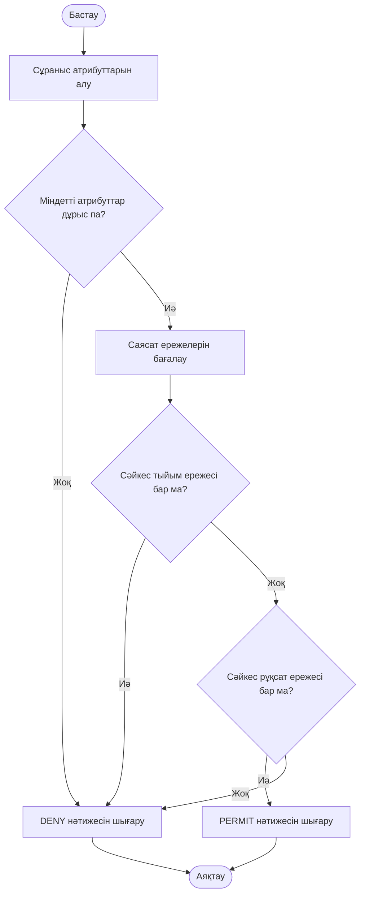
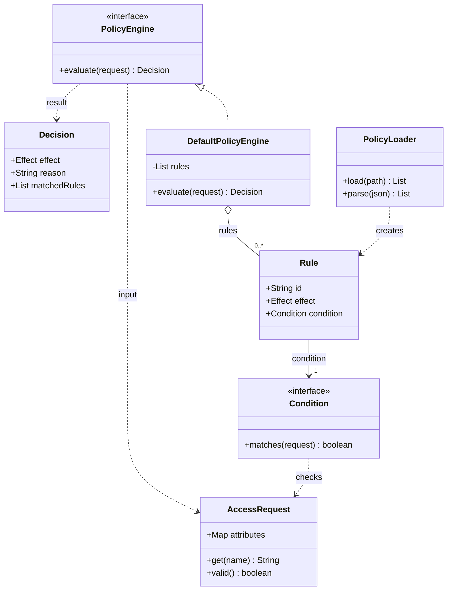
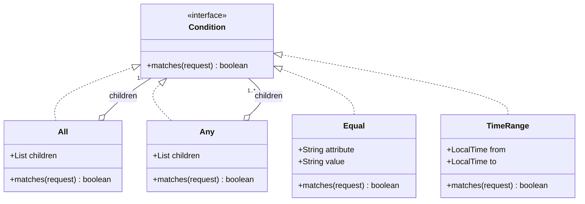
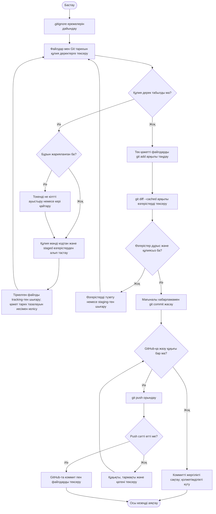

# ABAC Policy Engine

**Жоба тақырыбы:** №14 — ABAC саясат қозғалтқышы (ABAC Policy Engine)

**Бағдарламалау тілі:** Java  
**Жоба түрі:** Ақпараттық қауіпсіздік және қол жеткізуді басқару

---

## 1. Жоба туралы

ABAC (Attribute-Based Access Control) — атрибуттарға негізделген қол жеткізуді басқару моделі. Бұл модель пайдаланушының, ресурстың, орындалатын әрекеттің және қоршаған ортаның атрибуттарын тексеру арқылы жүйеге қол жеткізуге рұқсат береді немесе тыйым салады.

**ABAC Policy Engine** — JSON форматында сақталған саясат ережелерін оқып, сұраныстарды автоматты түрде тексеретін Java бағдарламасы.

## 2. Жобаның мақсаты

Java тілінде ABAC моделіне негізделген саясат қозғалтқышын әзірлеу. Жүйе пайдаланушы атрибуттарын саясат ережелерімен салыстырып, қол жеткізу туралы шешім қабылдайды.

## 3. Жобаның міндеттері

- ABAC моделінің жұмыс істеу принципін зерттеу.
- Пайдаланушы атрибуттарын анықтау.
- Ресурс және әрекет атрибуттарын сипаттау.
- JSON форматында саясат ережелерін құру.
- JSON файлынан саясаттарды оқу.
- Саясат шарттарын тексеру механизмін әзірлеу.
- PERMIT және DENY шешімдерін шығару.
- JUnit 5 арқылы кемінде 10 тест орындау.
- Қауіпсіздік талаптарын сақтау.

## 4. ABAC моделінің негізгі элементтері

| Элемент | Сипаттамасы | Мысал |
|---|---|---|
| Subject | Пайдаланушы | teacher |
| Resource | Қорғалатын ресурс | document |
| Action | Орындалатын әрекет | read |
| Environment | Қоршаған орта | department, time |

## 5. Жүйенің жұмыс істеу принципі

1. JSON файлынан саясат ережелері оқылады.
2. Пайдаланушы сұраныс жібереді.
3. Жүйе пайдаланушы, ресурс, әрекет және орта атрибуттарын алады.
4. Атрибуттар саясат шарттарымен салыстырылады.
5. Сәйкес тыйым ережесі болса, DENY шешімі беріледі; әйтпесе сәйкес рұқсат ережесі болса, PERMIT беріледі.
6. Рұқсат беретін саясат табылмаса, DENY шешімі қайтарылады.

## 6. Қолданылатын технологиялар

| Технология | Қолданылуы |
|---|---|
| Java 17 | Негізгі бағдарламалау тілі |
| Maven | Жобаны жинақтау |
| Jackson | JSON файлдарын өңдеу |
| JUnit 5 | Бағдарламаны тестілеу |
| Git | Код нұсқаларын басқару |
| GitHub | Жобаны сақтау |
| GitHub Actions | Автоматты тестілеу және жинақтау |
| JCA | Қажет болған жағдайда криптографиялық функциялар |

## 7. Жобаның құрылымы

```text
ABAC-Policy-Engine/
│
├── src/
│   ├── main/
│   │   ├── java/
│   │   │   └── kz/abac/
│   │   │       ├── Main.java
│   │   │       ├── model/
│   │   │       ├── engine/
│   │   │       └── loader/
│   │   └── resources/
│   │       └── policies.json
│   │
│   └── test/
│       └── java/
│           └── kz/abac/
│
├── .github/
│   └── workflows/
│       └── ci.yml
│
├── docs/
├── pom.xml
├── README.md
├── .gitignore
└── LICENSE
```

## 8. Қолданылатын Design Patterns (Жобалау паттерндері)

Жобаны әзірлеу барысында бағдарламаның құрылымын жақсарту,
кодтың қайталануын азайту және жүйені кеңейту мақсатында
келесі жобалау паттерндері қолданылады.

| № | Паттерн атауы | Қолданылу мақсаты |
|---|---|---|
| 1 | Strategy Pattern | Қолжетімділік саясатын тексерудің әртүрлі алгоритмдерін қолдану. |
| 2 | Factory Method Pattern | Саясат объектілерін құру процесін ұйымдастыру. |
| 3 | Chain of Responsibility Pattern | Қолжетімділік ережелерін кезекпен тексеру. |
| 4 | Builder Pattern | Пайдаланушы, ресурс және орта атрибуттарын құрастыру. |
| 5 | Singleton Pattern | Policy Engine объектісінің бір ғана данасын пайдалану. |

### Паттерндердің артықшылықтары

- Код құрылымын реттейді.
- Бағдарламаны кеңейтуге мүмкіндік береді.
- Кодтың қайталануын азайтады.
- Жүйені сүйемелдеуді жеңілдетеді.
- Бағдарламаның икемділігін арттырады.

## 9. UML диаграммалары

UML (Unified Modeling Language) — бағдарламалық жүйенің құрылымын, компоненттерін және олардың өзара байланысын графикалық түрде көрсетуге арналған модельдеу тілі.

ABAC Policy Engine жобасында UML диаграммасы жүйенің жұмыс істеу логикасын және негізгі компоненттердің байланысын түсіндіру үшін қолданылады.

### UML диаграммасының негізгі компоненттері

| Компонент | Қызметі |
|---|---|
| User (Subject) | Жүйеге сұраныс жіберетін пайдаланушы |
| Resource | Қолжетімділік сұралатын ресурс |
| Action | Орындалатын әрекет |
| Environment | Сұраныс орындалатын орта жағдайлары |
| Policy | Қолжетімділік ережелері |
| Policy Engine | Саясаттарды тексеретін негізгі механизм |
| Access Decision | Қолжетімділік нәтижесін шығарады |

### UML диаграммасының жұмыс істеу логикасы

1. Пайдаланушы жүйеге сұраныс жібереді.
2. Жүйе пайдаланушы, ресурс және әрекет туралы мәліметтерді алады.
3. Policy Engine тиісті саясаттарды тексереді.
4. Саясат шарттарына сәйкес шешім қабылдайды.
5. Нәтижесінде PERMIT немесе DENY жауабы беріледі.

### UML диаграммасының мақсаты

UML диаграммасы жүйенің құрылымын түсінуге, компоненттер арасындағы байланысты көрсетуге және жобаны әзірлеу процесін жеңілдетуге көмектеседі.


## 9.1 UML Activity Diagram

Бұл диаграмма ABAC Policy Engine жүйесінде пайдаланушының сұранысын тексеру және қолжетімділік туралы шешім қабылдау процесін көрсетеді.



### 9.2 UML Class — негізгі құрылым

Бұл диаграмма жобаланатын негізгі кластарды, интерфейсті және олардың байланыстарын көрсетеді. `AccessRequest` сұраныс атрибуттарын, `Rule` ережені, `Decision` тексеру нәтижесін сақтайды. `PolicyLoader` JSON ережелерін оқиды, ал `DefaultPolicyEngine` оларды бағалайды.



`PolicyEngine` — интерфейс; `DefaultPolicyEngine` оны жүзеге асырады. Қозғалтқыш бірнеше ережені тексереді. Бір ережеде бір шарт түйіні болады; ол күрделі ағаштың түбірі болуы мүмкін. Жобалауда **DENY-overrides** қағидасы қолданылады: сәйкес тыйым рұқсаттан басым; сәйкес рұқсат болмаса, әдепкі нәтиже — DENY.

### 9.3 UML Class — ережелер ағашы

`Condition` — шартты тексеретін ортақ интерфейс. `All` барлық ішкі шарттың орындалуын, `Any` кемінде бір ішкі шарттың орындалуын тексереді. `Equal` атрибут мәнін салыстырады, `TimeRange` уақыт аралығын тексереді. Бұл құрылым **Composite** тәсілін көрсетеді.



`children` — ішкі шарттар тізімі. Мысалы: ALL(ANY(employee, admin), corporate, office, 09:00–18:00). Жоғарыдағы атаулар архитектураны жобалауға арналған. Алдыңғы Java прототипінде `All`, `Any`, `Equal`, `TimeRange` — `Conditions` ішіндегі типтер; рұқсат нәтижесі `ALLOW` деп аталады. Осы README-дегі `PERMIT` — сол рұқсат ұғымының атауы.

### 9.4 UML Activity — құпия деректерді тексеру және коммит жасау

**16/11 кезеңі.** Бұл диаграмма әзірлеушінің `.gitignore` дайындау, құпия деректерді тексеру, коммит жасау және GitHub-қа жіберу әрекеттерін көрсетеді. Activity логикасы GitHub қолдайтын Mermaid flowchart пішімінде берілген.

Алғышарт: README тарихы сақталған жергілікті Git репозиторийі (clone) бар. ZIP-тен шығарылған қарапайым папкада Git тарихы болмауы мүмкін; мұндай жағдайда бастапқы репозиторийге қолжетімділік алып, оны clone жасау керек.



**Бұл диаграмма командаларды өзі орындамайды.** Ол тек жұмыс ретін сипаттайды. Нақты репозиторий файлдары мен тарихы тексерілмейінше «құпия деректер жоқ» деп, ал `git commit` орындалмайынша «коммит жасалды» деп есептелмейді.

#### Негізгі тексеру командалары

Репозиторийдің түбіріндегі терминалда:

```bash
git status --short
git ls-files ".env" ".env.*" "*.key" "*.pem" "*.p12" "*.pfx" "*.jks" "*.keystore" "secrets/*"
git check-ignore .env .env.local secrets/example.txt example.key
git diff --cached
git log --all --oneline
git log --all --name-only --pretty=format:
```

- `git ls-files` құпия файлдың Git-те тіркеліп тұрғанын анықтауға көмектеседі. `.env.example` шығуы мүмкін, бірақ онда нақты құпия мән болмауы керек.
- `git check-ignore` файл атауларының `.gitignore` ережелеріне сәйкестігін тексереді.
- `git diff --cached` коммитке кіретін өзгерістерді көрсетеді. Құпия мән көрінсе, оны скриншотқа немесе чатқа жібермеңіз.
- `git log` тарихты шолуға көмектеседі. Бұл командалар барлық құпияны автоматты табатын толық аудит емес: файлдардың мазмұнын және бұрынғы нұсқаларын да тексеру керек.
- `.gitignore` бұрын тіркелген файлдарды немесе ескі коммиттерді өздігінен тазаламайды.

#### Осы README өзгерісіне коммит мысалы

Файлды репозиторийде `README.md` атымен сақтап, мазмұнын тексергеннен кейін:

```bash
git add README.md
git diff --cached -- README.md
git commit -m "docs: add ABAC class and secure commit workflow diagrams"
```

Бұл — бір мағыналы өзгеріске арналған коммит үлгісі. Ол орындалған коммит емес және «15 коммит, бірнеше аптаға жайылған» талабын жалғыз өзі орындамайды. GitHub-қа қолжетімділік берілгенде ғана тиісті тармаққа `git push` жасалады.

## 10. Күтілетін нәтиже

Рұқсат беретін сұраныс:

```text
Subject: teacher
Resource: document
Action: read
Department: IT

Decision: PERMIT
```

Рұқсат берілмейтін сұраныс:

```text
Subject: guest
Resource: document
Action: delete

Decision: DENY
```

*Бұл нәтижелер бағдарламаның жоспарланған жұмысын көрсететін мысалдар.*

## 11. Тестілеу

Жоба JUnit 5 көмегімен тексеріледі.

Тестілеу сценарийлері:

1. Дұрыс пайдаланушыға рұқсат беру.
2. Белгісіз рөлге тыйым салу.
3. Ресурс түрін тексеру.
4. Әрекет түрін тексеру.
5. Барлық атрибуттардың сәйкестігін тексеру.
6. Әкімшіге рұқсат беру.
7. Тыйым салу ережесін тексеру.
8. JSON файлын оқу.
9. Сәйкес саясат болмаған жағдайды тексеру.
10. Қате JSON файлын өңдеу.

## 12. Қауіпсіздік талаптары

- Парольдер мен API кілттерін GitHub-қа жүктемеу.
- Құпия деректерді код ішінде сақтамау.
- `.gitignore` файлын пайдалану.
- Қате сұраныстарға автоматты түрде рұқсат бермеу.
- JSON файлындағы деректерді тексеру.
- Қол жеткізу шешімдерін журналға жазу.
- Қажет криптографиялық операциялар үшін Java JCA стандарттарын пайдалану.


## 13. Қорытынды

ABAC Policy Engine жобасы Java тілінде атрибуттарға негізделген қол жеткізуді басқару жүйесін әзірлеуге арналған. Жоба пайдаланушының, ресурстың, әрекеттің және ортаның атрибуттарын тексеру арқылы қауіпсіздік саясатына сәйкес шешім қабылдайды.

Жобаны орындау барысында Java, Maven, JSON, JUnit 5 және GitHub технологиялары қолданылады.

---

**Жоба тақырыбы:** №14 — ABAC саясат қозғалтқышы  
**Орындаушы:** Реймқұл Ақерке
